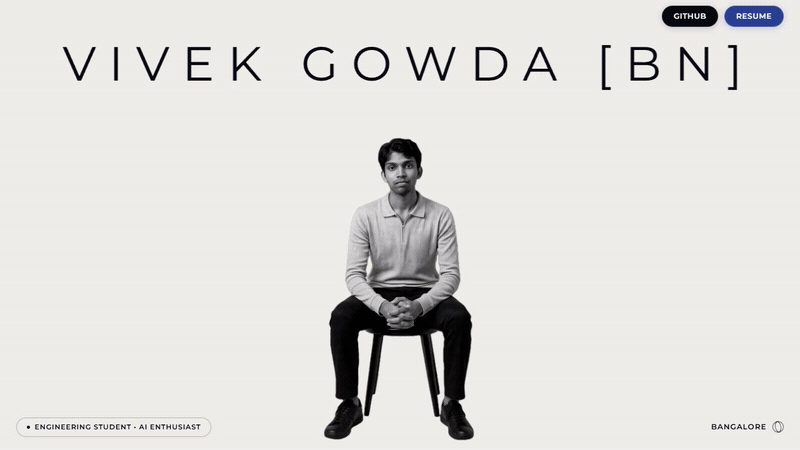

<div align="center">

# Vivek Gowda BN — Portfolio & Creative Engineering

<p align="center">
  <strong>A high-performance creative development portfolio featuring bespoke 3D motion design, Lenis smooth scrolling, SVG paint transitions, and responsive micro-interactions.</strong>
</p>

<!-- ═══════════════════════════════════════════════════════════════
     PORTFOLIO DEMO VIDEO (Top of README)
     ═══════════════════════════════════════════════════════════════ -->

<a href="public/assets/portfolio-preview.mp4">
  <video src="public/assets/portfolio-preview.mp4" width="100%" autoplay loop muted playsinline poster="public/assets/portfolio-preview.gif">
    
  </video>
</a>

<p align="center">
  <em>Full Page Walkthrough • From Parallax Hero to 3D TiltedCards & Open-The-Door Contact</em>
  <br />
  <sub><a href="public/assets/portfolio-preview.mp4">▶ Click here to view / download full-quality MP4 (1080p / 60fps)</a></sub>
</p>

<p align="center">
  
  
  
  
  
  
  
</p>

</div>

---

## ✦ Overview

This portfolio is a creative development showcase engineered with a luxury editorial aesthetic, drawing inspiration from design studios like **Pamidor Design** and **Alejandro HA**.

It balances typography (**Funnel Display** & **Montserrat**), physics-based cursor interactions, custom SVG paint masking shaders, and GPU-accelerated motion systems into a seamless single-page experience.

---

## 🎯 Key Sections & Motion Architecture

### 1. Hero Section
- **Dynamic Name SVG**: Bespoke typographic SVG signature anchored on the canvas with scale-and-pin scrub transitions.
- **Background-less Subject Portrait**: High-resolution subject sitting directly on the canvas tone (`#EFEEEB`).
- **Glassmorphic Navigation Bar**: Frosted blur navbar with custom button-007 SVG paint sweep hover states for GitHub and Resume buttons.
- **3D Wireframe Rotating Globe**: Live Three.js / CSS 3D coordinate sphere representing Bengaluru, India (`12.9716° N, 77.5946° E`).

### 2. About Section
- **Letter-by-Letter Char-Wave Scroll**: Body paragraphs driven by scroll position where each letter illuminates progressively (`data-char`, `data-lit`) with a flash of electric blue.
- **Hover Portrait (Color → B&W)**: Color portrait that shifts to crisp black-and-white on hover.
- **Pamidor Floating Mouse Trail**: 6 floating photo cards follow cursor momentum with cubic-bezier Web Animations API easing, gradient masking, and portfolio-blue color grading.

### 3. Transition: "Small Details. Big Impact"
- **Alejandro HA Paint Swipe**: Full-width SVG brush stroke that scrolls into view and progressively paints the viewport solid blue (`#2A4093`).

### 4. Selected Work (Compact Project Drawer)
- High-contrast project rows built on deep blue canvas.
- Hovering any item expands a smooth drawer revealing project snapshots, tech stack chips, and live links without clutter.

### 5. Experience (3D Interactive TiltedCards)
- **Front Face**: Custom imagery, bold role typography, company name, and stylized numeric badges (`01` / `02`).
- **Dynamic Glare & Tilt**: Framer Motion spring physics tracking mouse coordinate offsets with real-time radial reflection glare.
- **3D Flip on Click**: Card rotates 180° around the Y-axis to reveal detailed responsibilities, key achievements, and client/employer links.

### 6. Achievements (Accordion Gallery)
- Pure black (`#000000`) showcase with horizontal expanding cards highlighting awards (FKCCI Inno Manthan Grand Finalist, ₹70,000 Special Grant winner).

### 7. Contact ("Open The Door")
- Full-screen ambient sky/cloud background video.
- Deep night glassmorphism inquiry card with interactive form inputs.

---

## 🛠️ Tech Stack

| Category | Technologies |
| :--- | :--- |
| **Frontend Framework** | [React 19](https://react.dev/), [Vite 8](https://vitejs.dev/) |
| **Motion & Animation** | [GSAP](https://gsap.com/) (ScrollTrigger), [Framer Motion 12](https://www.framer.com/motion/) |
| **3D & Canvas** | [Three.js](https://threejs.org/), [@react-three/fiber](https://docs.pmnd.rs/react-three-fiber), [@react-three/drei](https://github.com/pmndrs/drei) |
| **Smooth Scrolling** | [@studio-freight/lenis](https://lenis.darkroom.engineering/) |
| **Typography** | Funnel Display, Montserrat, Inter |
| **Tooling & Linter** | [Oxlint](https://oxc.rs/) |

---

## 🚀 Getting Started

### Prerequisites

- [Node.js](https://nodejs.org/) `>= 18.0.0`
- `npm` (or `pnpm` / `yarn`)

### 1. Clone the repository

```bash
git clone https://github.com/VivekGowda-BN/portfolio.git
cd portfolio
```

### 2. Install dependencies

```bash
npm install
```

### 3. Run development server

```bash
npm run dev
```

Visit `http://localhost:5173` in your browser.

### 4. Production build

```bash
npm run build
```

Preview the production build locally:

```bash
npm run preview
```

### 5. Run Linter

```bash
npx oxlint
```

---

## 📂 Project Architecture

```
portfolio/
├── public/
│   ├── assets/                 # Video previews, portraits, project imagery
│   │   ├── portfolio-preview.mp4 # Full walkthrough video
│   │   ├── portfolio-preview.gif # Animated fallback walkthrough
│   │   └── ...
│   ├── favicon.svg
│   └── icons.svg
├── src/
│   ├── components/             # Self-contained section components
│   │   ├── Header.jsx          # Glass navbar with SVG paint hover
│   │   ├── Hero.jsx            # Canvas portrait & rotating 3D globe
│   │   ├── About.jsx           # Char-wave scroll text & floating trail
│   │   ├── Transition.jsx      # Blue paint brush transition
│   │   ├── Projects.jsx        # Selected work accordion
│   │   ├── Experience.jsx      # Experience section container
│   │   ├── TiltedCard.jsx      # React Bits 3D interactive flip card
│   │   ├── AccordionGallery.jsx# Milestone cards gallery
│   │   ├── Contact.jsx         # Contact form with background sky video
│   │   └── Footer.jsx          # Live timezone clock & links
│   ├── App.jsx                 # Lenis smooth scroll & layout orchestrator
│   ├── index.css               # Global theme tokens, typography, CSS variables
│   └── main.jsx                # Application root
├── .env.example                # Safe environment template
├── .gitignore                  # Open-source privacy protection rules
├── package.json
└── vite.config.js
```

---

## 🛡️ Open Source & Privacy Ready

This repository is prepared for public open-source hosting:
- Private notes, draft content (`content.md`), and scraper reference logs (`*.txt`) are strictly excluded via `.gitignore`.
- Environment credentials and API tokens are hidden.
- Clean `.env.example` provided for external contributors.

---

## 📄 License

This project is open-source under the [MIT License](LICENSE). Feel free to explore the code, learn from the motion implementations, and adapt the concepts for your own work.

---

<div align="center">
  <sub>Designed & Developed with precision by <strong>Vivek Gowda BN</strong></sub>
</div>
